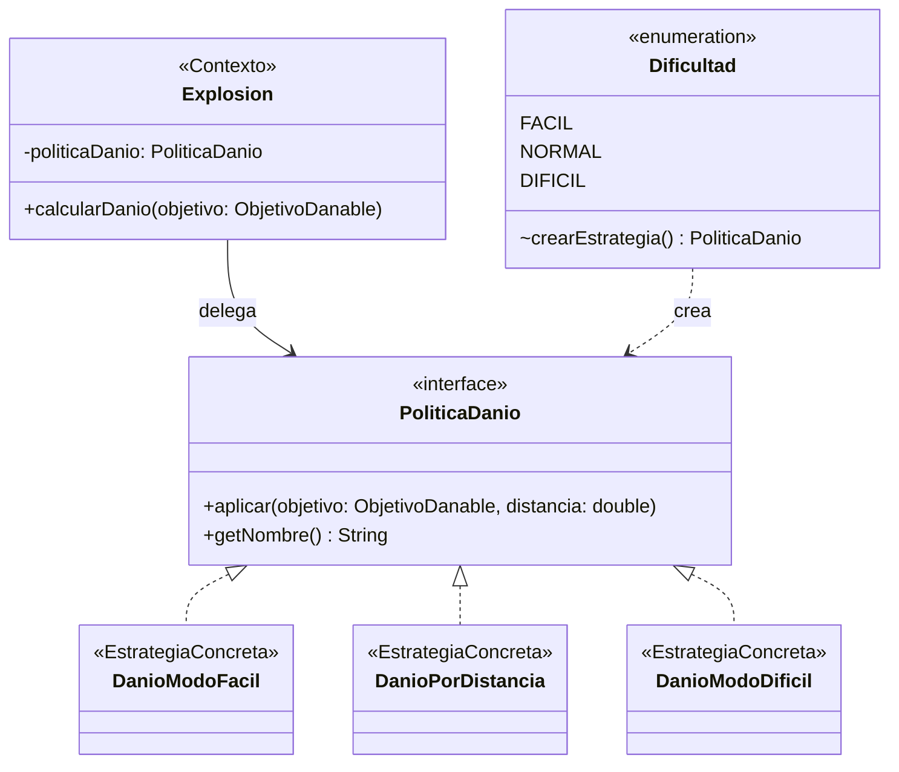
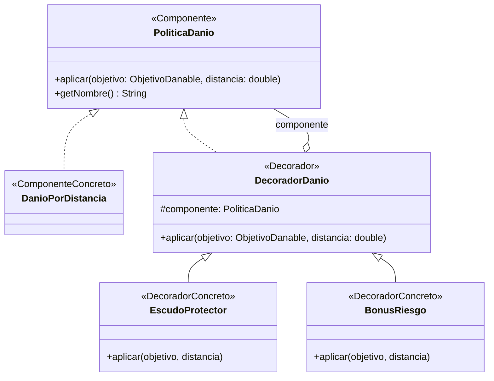
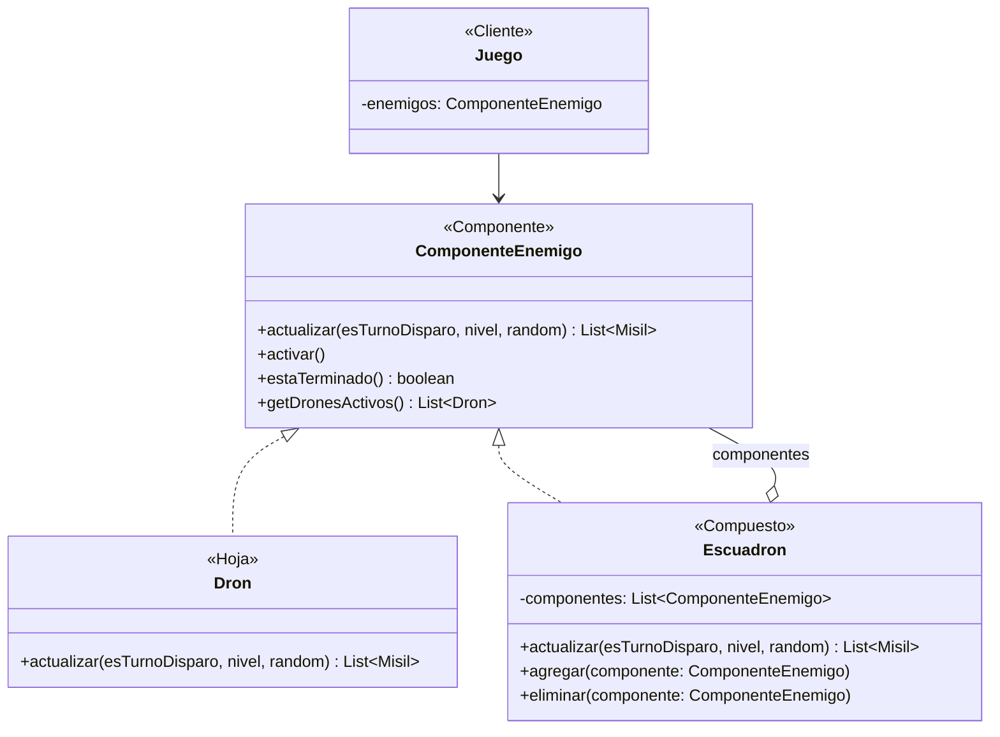
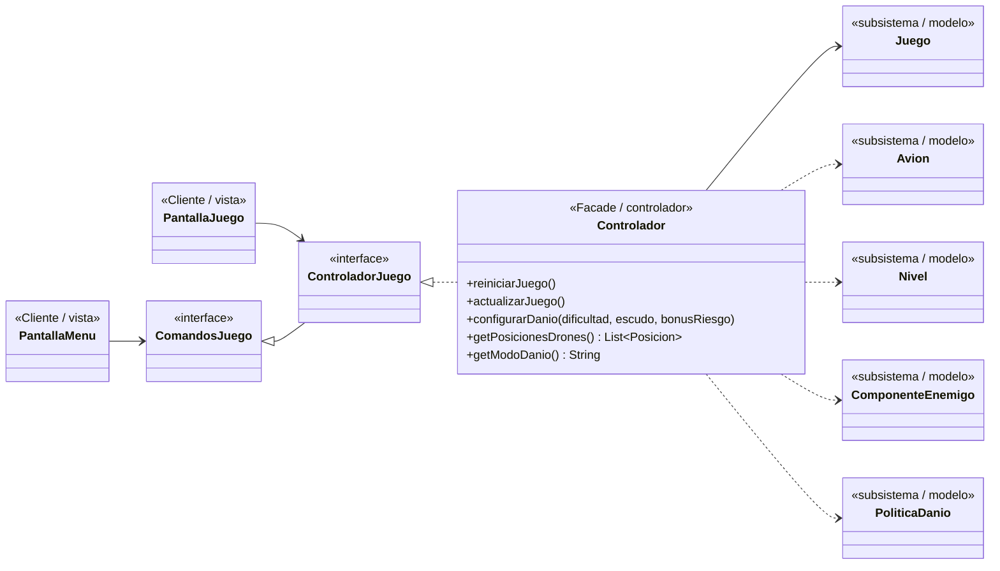

# Diagramas de clases — Iteración 4 (final)

Incluye todas las clases del proyecto, agrupadas por capa MVC (`modelo`,
`controlador`, `vista`). Los signos indican visibilidad:

- `-` privado
- `#` protegido
- `~` de paquete
- `+` publico

Patrones aplicados en esta iteración (además de GRASP y SOLID de las anteriores):

| Patrón | Tipo | Clases |
|---|---|---|
| **Strategy** | Comportamiento | `PoliticaDanio` (estrategia), `DanioModoFacil` / `DanioPorDistancia` / `DanioModoDificil` (estrategias concretas), `Explosion` (contexto) |
| **Decorator** | Estructural | `PoliticaDanio` (componente), `DecoradorDanio` (decorador), `EscudoProtector` / `BonusRiesgo` (decoradores concretos) |
| **Composite** | Estructural | `ComponenteEnemigo` (componente), `Dron` (hoja), `Escuadron` (compuesto) |
| **Facade** | Estructural | `Controlador` (facade), la vista (cliente), las clases del modelo (subsistema) |
| **MVC** | Arquitectura | paquetes `modelo`, `controlador`, `vista` |

## Diagrama de clases completo

`Controlador` implementa todos los métodos de `ComandosJuego` y `ConsultasJuego`;
para no repetirlos, en su caja solo figuran los propios y los de esta iteración.

```mermaid
classDiagram
    direction TB

    namespace modelo {
        class Posicionable {
            <<interface>>
            +getPosX() double
            +getAltitud() double
        }

        class ObjetivoDanable {
            <<interface>>
            +agregarPuntos(cantidad: int)
            +perderEnergia(porcentaje: double)
            +perderVida()
        }

        class EntidadVoladora {
            <<abstract>>
            #posX: double
            #altitud: double
            +EntidadVoladora(posX: double, altitud: double)
            +getPosX() double
            +getAltitud() double
        }

        class Avion {
            -POS_X_MIN: double
            -POS_X_MAX: double
            -ALTITUD_MIN: double
            -ALTITUD_MAX: double
            -ENERGIA_MAX: double
            -energia: double
            -vidas: int
            -puntos: int
            +Avion(posX: double, altitud: double, vidas: int)
            +mover(dir: Direccion, delta: double)
            +cambiarAltitud(delta: double)
            +recibirExplosion(explosion: Explosion)
            +recibirImpacto()
            +perderEnergia(porcentaje: double)
            +perderVida()
            +agregarPuntos(cantidad: int)
            +agregarVida()
            +estaVivo() boolean
            +getEnergia() double
            +getVidas() int
            +getPuntos() int
        }

        class ComponenteEnemigo {
            <<interface>>
            +actualizar(esTurnoDisparo: boolean, nivel: Nivel, random: Random) List~Misil~
            +activar()
            +estaTerminado() boolean
            +getDronesActivos() List~Dron~
        }

        class Dron {
            -POS_X_MIN: double
            -POS_X_MAX: double
            -ALTITUD_DRON: double
            -velocidad: double
            -direccion: Direccion
            -activo: boolean
            -completoRecorrido: boolean
            +Dron(direccion: Direccion, velocidad: double)
            +Dron(direccion: Direccion, velocidad: double, altitud: double)
            +mover()
            -completarRecorrido()
            +disparar(velocidadCaida: double) Misil
            +disparar(velocidadCaida: double, random: Random) Misil
            +actualizar(esTurnoDisparo: boolean, nivel: Nivel, random: Random) List~Misil~
            +activar()
            +estaTerminado() boolean
            +getDronesActivos() List~Dron~
            +completoRecorrido() boolean
            +getDireccion() Direccion
            +isActivo() boolean
            +setActivo(activo: boolean)
        }

        class Escuadron {
            -TOTAL_DRONES: int
            -MAX_ACTIVOS: int
            -ALTITUD_BASE: double
            -SEPARACION_VERTICAL: double
            -componentes: List~ComponenteEnemigo~
            -enVuelo: List~ComponenteEnemigo~
            -siguiente: int
            -random: Random
            +Escuadron(nivel: Nivel)
            +Escuadron(nivel: Nivel, random: Random)
            +Escuadron(random: Random)
            -inicializarDrones(nivel: Nivel)
            +agregar(componente: ComponenteEnemigo)
            +eliminar(componente: ComponenteEnemigo)
            +actualizar(esTurnoDisparo: boolean, nivel: Nivel, random: Random) List~Misil~
            +activar()
            +estaTerminado() boolean
            +getDronesActivos() List~Dron~
            +activarSiguiente()
            +notificarCompletado(componente: ComponenteEnemigo)
            -calcularTamanioTanda() int
            +estaCompleto() boolean
            +getTodos() List~ComponenteEnemigo~
            +getActivos() int
        }

        class Nivel {
            -INCREMENTO: double
            -VEL_DRONES_BASE: double
            -VEL_MISILES_BASE: double
            -FREC_DISPARO_BASE: double
            -PROB_DISPARO_BASE: double
            -PROB_DISPARO_MAX: double
            -numero: int
            -velDrones: double
            -velMisiles: double
            -frecDisparo: double
            -probDisparo: double
            +Nivel()
            +avanzar()
            +getNumero() int
            +getVelDrones() double
            +getVelMisiles() double
            +getFrecDisparo() double
            +getProbDisparo() double
        }

        class Misil {
            -ALT_DET_MIN: double
            -ALT_DET_MAX: double
            -RADIO_IMPACTO: double
            -RANDOM_POR_DEFECTO: Random
            -altitudDetonacion: double
            -velocidadCaida: double
            -explotado: boolean
            +Misil(posX: double, altitudInicial: double, velocidadCaida: double)
            +Misil(posX: double, altitudInicial: double, velocidadCaida: double, random: Random)
            +Misil(posX: double, altitudInicial: double, velocidadCaida: double, altitudDetonacion: double)
            +mover()
            +impacta(avion: Avion, altitudAnterior: double) boolean
            +debeExplotar() boolean
            +explotar() Explosion
            +explotar(politicaDanio: PoliticaDanio) Explosion
            +getAltitudDetonacion() double
        }

        class Explosion {
            -POLITICA_POR_DEFECTO: PoliticaDanio
            -posX: double
            -altitud: double
            -politicaDanio: PoliticaDanio
            +Explosion(posX: double, altitud: double)
            +Explosion(posX: double, altitud: double, politicaDanio: PoliticaDanio)
            +calcularDanio(objetivo: ObjetivoDanable)
            +calcularDistancia(objetivo: Posicionable) double
            +getPosX() double
            +getAltitud() double
        }

        class PoliticaDanio {
            <<interface>>
            +aplicar(objetivo: ObjetivoDanable, distancia: double)
            +getNombre() String
        }

        class DanioModoFacil {
            -DISTANCIA_SEGURA: double
            -DISTANCIA_MEDIA: double
            -DISTANCIA_CRITICA: double
            +aplicar(objetivo: ObjetivoDanable, distancia: double)
            +getNombre() String
        }

        class DanioPorDistancia {
            -DISTANCIA_SEGURA: double
            -DISTANCIA_MEDIA: double
            -DISTANCIA_CRITICA: double
            +aplicar(objetivo: ObjetivoDanable, distancia: double)
            +getNombre() String
        }

        class DanioModoDificil {
            -DISTANCIA_SEGURA: double
            -DISTANCIA_MEDIA: double
            -DISTANCIA_CRITICA: double
            +aplicar(objetivo: ObjetivoDanable, distancia: double)
            +getNombre() String
        }

        class DecoradorDanio {
            <<abstract>>
            #componente: PoliticaDanio
            #DecoradorDanio(componente: PoliticaDanio)
            +aplicar(objetivo: ObjetivoDanable, distancia: double)
            +getNombre() String
        }

        class EscudoProtector {
            ~ABSORCION: double
            +EscudoProtector(componente: PoliticaDanio)
            +aplicar(objetivo: ObjetivoDanable, distancia: double)
            +getNombre() String
        }

        class BonusRiesgo {
            ~DISTANCIA_RIESGO: double
            ~PUNTOS_BONUS: int
            +BonusRiesgo(componente: PoliticaDanio)
            +aplicar(objetivo: ObjetivoDanable, distancia: double)
            +getNombre() String
        }

        class GestorMisiles {
            -ALTITUD_MINIMA_VUELO: double
            -misilesActivos: List~Misil~
            -explosionesRecientes: List~Explosion~
            -politicaDanio: PoliticaDanio
            +agregar(misil: Misil)
            +actualizar(avion: Avion)
            +setPoliticaDanio(politicaDanio: PoliticaDanio)
            +getPoliticaDanio() PoliticaDanio
            +limpiar()
            +limpiarExplosiones()
            +hayMisilesActivos() boolean
            +getMisilesActivos() List~Misil~
            +getExplosionesRecientes() List~Explosion~
        }

        class Juego {
            -VIDAS_INICIALES: int
            -POS_X_INICIAL: double
            -ALTITUD_INICIAL: double
            -FPS: int
            -PUNTOS_NIVEL: int
            -random: Random
            -gestorMisiles: GestorMisiles
            -nivel: Nivel
            -avion: Avion
            -enemigos: ComponenteEnemigo
            -enCurso: boolean
            -tickDisparo: int
            +Juego()
            +Juego(random: Random)
            +iniciar()
            -crearEnemigos() ComponenteEnemigo
            +reiniciarPartida()
            +actualizar()
            -actualizarEnemigos(esTurnoDisparo: boolean)
            -verificarNivelSuperado()
            +moverAvion(direccion: Direccion, delta: double)
            +cambiarAltitudAvion(delta: double)
            +setPoliticaDanio(politicaDanio: PoliticaDanio)
            +getPoliticaDanio() PoliticaDanio
            +getNivel() Nivel
            +getAvion() Avion
            +getEnemigos() ComponenteEnemigo
            +getMisilsActivos() List~Misil~
            +getExplosionesRecientes() List~Explosion~
            +isEnCurso() boolean
        }

        class Direccion {
            <<enumeration>>
            IZQUIERDA_DERECHA
            DERECHA_IZQUIERDA
        }
    }

    namespace controlador {
        class ComandosJuego {
            <<interface>>
            +iniciarJuego()
            +actualizarJuego()
            +reiniciarJuego()
            +moverAvionIzquierda(delta: double)
            +moverAvionDerecha(delta: double)
            +cambiarAltitudAvion(delta: double)
            +configurarDanio(dificultad: Dificultad, escudo: boolean, bonusRiesgo: boolean)
        }

        class ConsultasJuego {
            <<interface>>
            +getPuntos() int
            +getVidas() int
            +getEnergia() double
            +getPosXAvion() double
            +getAltAvion() double
            +avionVivo() boolean
            +getNumeroNivel() int
            +juegoEnCurso() boolean
            +getPosicionesDrones() List~Posicion~
            +getPosicionesMisiles() List~Posicion~
            +getPosicionesExplosiones() List~Posicion~
            +getModoDanio() String
        }

        class ControladorJuego {
            <<interface>>
        }

        class Controlador {
            -juego: Juego
            +Controlador()
            +Controlador(juego: Juego)
            +configurarDanio(dificultad: Dificultad, escudo: boolean, bonusRiesgo: boolean)
            +getModoDanio() String
            -aPosicion(p: Posicionable) Posicion
        }

        class Dificultad {
            <<enumeration>>
            FACIL
            NORMAL
            DIFICIL
            -nombre: String
            -fabrica: Supplier~PoliticaDanio~
            +getNombre() String
            ~crearEstrategia() PoliticaDanio
        }

        class Posicion {
            <<record>>
            +x: double
            +altitud: double
        }
    }

    namespace vista {
        class VentanaPrincipal {
            +ANCHO: int$
            +ALTO: int$
            -controlador: ControladorJuego
            -cardLayout: CardLayout
            -contenedor: JPanel
            -pantallaMenu: PantallaMenu
            -pantallaJuego: PantallaJuego
            +VentanaPrincipal(controlador: ControladorJuego)
            +mostrarMenu()
            +mostrarJuego()
        }

        class PantallaMenu {
            -ventana: VentanaPrincipal
            -comandos: ComandosJuego
            -dificultad: Dificultad
            -escudo: boolean
            -bonusRiesgo: boolean
            +PantallaMenu(ventana: VentanaPrincipal, comandos: ComandosJuego)
            -construirUI()
            -agregarSelectorDificultad(gbc: GridBagConstraints, skin: Skin)
            -agregarSelectorModificadores(gbc: GridBagConstraints, skin: Skin)
            #paintComponent(g: Graphics)
        }

        class PantallaJuego {
            -ctrl: ControladorJuego
            -ventana: VentanaPrincipal
            -timer: Timer
            -animaciones: List~ExplosionAnim~
            +PantallaJuego(ventana: VentanaPrincipal, ctrl: ControladorJuego)
            +iniciar()
            +pause()
            +reiniciar()
            +actionPerformed(e: ActionEvent)
            #paintComponent(g: Graphics)
        }

        class SkinManager {
            -actual: Skin$
            +getActual() Skin$
            +setActual(s: Skin)$
        }

        class Skin {
            <<enumeration>>
            COSMOS
            INFERNO
        }
    }

    class Main {
        +main(args: String[])$
    }

    %% ── Herencia / realizacion (modelo) ──
    Posicionable <|.. EntidadVoladora
    Posicionable <|.. Explosion
    Posicionable <|-- ObjetivoDanable
    ObjetivoDanable <|.. Avion
    EntidadVoladora <|-- Avion
    EntidadVoladora <|-- Dron
    EntidadVoladora <|-- Misil

    %% ── COMPOSITE ──
    ComponenteEnemigo <|.. Dron : hoja
    ComponenteEnemigo <|.. Escuadron : compuesto
    Escuadron "1" o-- "0..*" ComponenteEnemigo : componentes

    %% ── STRATEGY ──
    PoliticaDanio <|.. DanioModoFacil
    PoliticaDanio <|.. DanioPorDistancia
    PoliticaDanio <|.. DanioModoDificil
    Explosion --> PoliticaDanio : estrategia

    %% ── DECORATOR ──
    PoliticaDanio <|.. DecoradorDanio
    DecoradorDanio o-- "1" PoliticaDanio : componente
    DecoradorDanio <|-- EscudoProtector
    DecoradorDanio <|-- BonusRiesgo

    %% ── Asociaciones del modelo ──
    Juego "1" *-- "1" Avion
    Juego "1" *-- "1" Nivel
    Juego "1" *-- "1" GestorMisiles
    Juego "1" --> "1" ComponenteEnemigo : enemigos
    GestorMisiles "1" o-- "0..*" Misil : misiles activos
    GestorMisiles "1" o-- "0..*" Explosion : explosiones recientes
    GestorMisiles --> PoliticaDanio : politica activa
    Escuadron ..> Dron : crea
    Escuadron ..> Nivel : obtiene velocidad
    Dron --> Direccion
    Dron ..> Misil : crea al disparar
    Misil ..> Explosion : crea al explotar
    Misil ..> Avion : determina si impacta
    Explosion ..> ObjetivoDanable : dania
    Avion ..> Direccion : recibe movimiento

    %% ── Controlador (FACADE) ──
    ComandosJuego <|-- ControladorJuego
    ConsultasJuego <|-- ControladorJuego
    ControladorJuego <|.. Controlador
    Controlador --> Juego : facade
    Controlador ..> Dificultad
    Controlador ..> EscudoProtector : decora
    Controlador ..> BonusRiesgo : decora
    Controlador ..> Posicion : crea
    Dificultad ..> PoliticaDanio : crea estrategia

    %% ── Vista ──
    Main ..> Controlador : crea
    Main ..> VentanaPrincipal : crea
    VentanaPrincipal --> ControladorJuego
    VentanaPrincipal *-- PantallaMenu
    VentanaPrincipal *-- PantallaJuego
    PantallaMenu --> ComandosJuego
    PantallaMenu ..> Dificultad : elige
    PantallaJuego --> ControladorJuego
    PantallaJuego ..> Posicion : dibuja
    PantallaMenu ..> SkinManager
    PantallaJuego ..> SkinManager
    SkinManager --> Skin
```

## Strategy — dificultad

El jugador elige la dificultad en el menú. `Explosion` (contexto) calcula la
distancia y delega el efecto en la estrategia, sin saber cuál es.

## Decorator — modificadores de daño

Los decoradores envuelven cualquier estrategia y se pueden apilar:
`new BonusRiesgo(new EscudoProtector(new DanioModoDificil()))`.
`EscudoProtector` actúa **antes** de delegar (aleja la explosión 30 m) y
`BonusRiesgo` **después** (+10 puntos si la explosión fue a 150 m o menos).

## Composite — enemigos

`Juego` solo conoce `ComponenteEnemigo`: le da igual que sea un dron o un
escuadrón (que a su vez puede contener otros escuadrones).

## Facade y MVC

La vista (cliente) solo habla con el controlador (facade) a través de
interfaces; el controlador coordina el subsistema del modelo. La vista nunca
importa clases del modelo: recibe `Posicion` y elige la dificultad con el enum
`Dificultad` del controlador.

