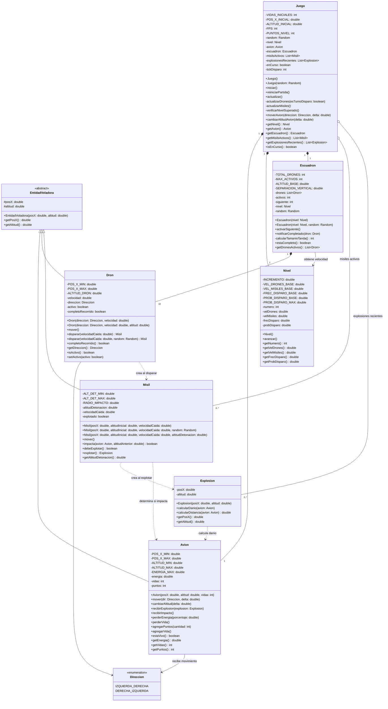
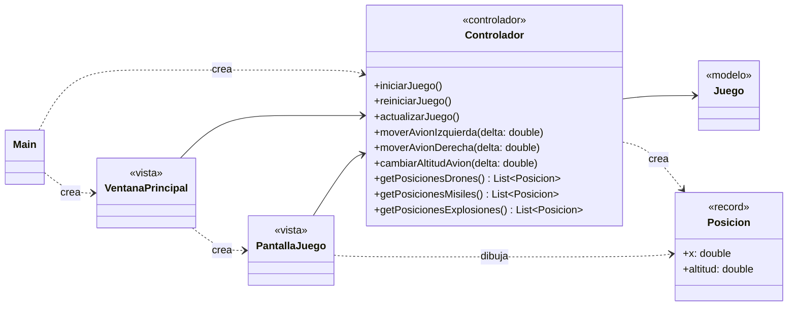

# Diagrama de clases del dominio

El diagrama incluye solamente las clases del modelo. Los signos indican visibilidad:

- `-` privado
- `#` protegido
- `+` publico

# Diagrama de capas (MVC)

La vista **no conoce las clases del modelo**: el controlador le entrega `Posicion`
(x, altitud) para drones, misiles y explosiones, y recibe comandos de movimiento.
El controlador se crea en `Main` y se inyecta en la vista.

